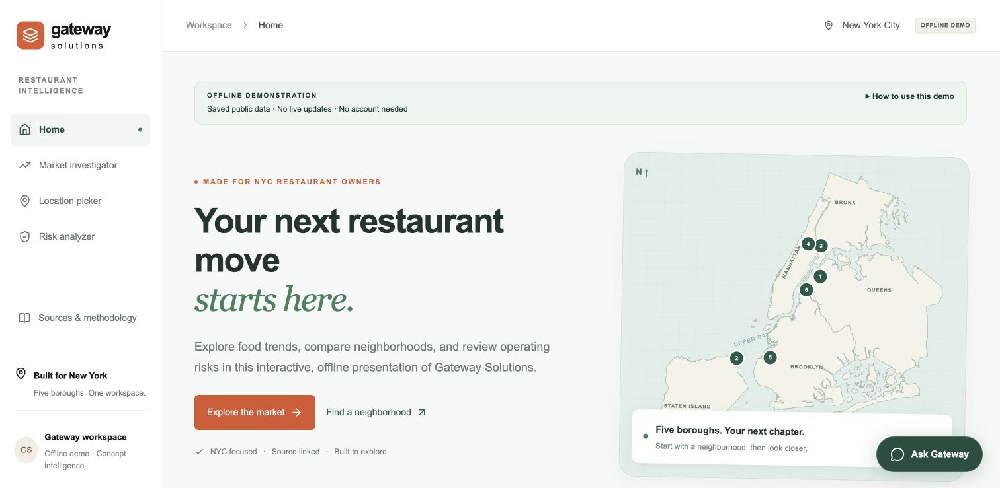

# Gateway Solutions | NYC Restaurant Intelligence

An English-language research platform that helps New York City restaurant owners explore food-market signals, compare neighborhoods, and identify policies worth reviewing.



## Start here

**To review the project without installing anything:** download this repository using **Code → Download ZIP**, unzip it, and open [`demo/Gateway_Solutions_Demo.html`](demo/Gateway_Solutions_Demo.html) in Chrome, Edge, or Safari. If double-clicking opens an editor, choose **Open With → your browser**. GitHub's file viewer shows the HTML source; download it before opening it.

The demo bundles its scripts, styles, map, and saved data. Its core interactions work offline. See [`demo/START_HERE.txt`](demo/START_HERE.txt) for a five-minute walkthrough and snapshot dates. External source links require internet access.

**For the research methodology:** download the [Workflow and Validation Guide (Word)](docs/Gateway_Solutions_Workflow_and_Validation_Guide.docx). It describes data sources, recommendation rules, validation, and limitations. [Implementation notes](docs/IMPLEMENTATION.md) describe routes and caching in more detail.

## Features

- **Home:** introduces the platform and its three research tools.
- **Market Investigator:** weekly restaurant-news coverage, cuisine shares, bar charts, and donut charts. Restaurant presence and news attention are separate measures; neither measures consumer demand.
- **Location Picker:** fifteen restaurant concepts, eight candidate neighborhoods, map-based comparison, and rankings that change with the concept, rent budget, and borough. Cuisine presence comes from restaurant records; rent and transit inputs remain illustrative.
- **Risk Analyzer:** a restaurant-concept operating profile, concept-specific checks, relevant headlines, and prioritized official notices. Reference calculations and policy notices remain separate; a notice does not automatically change a rule.
- **Ask Gateway:** a rule-based research assistant on every page, with English/Chinese questions, follow-up context, and source links. It is not a generative-AI service. Conversations stay in browser memory and do not automatically update the website.

## Project status

This repository contains the upgraded working source and the separate offline presentation copy. Uploading it to GitHub does **not** deploy those upgrades to the existing website.

- Existing website: [Gateway NYC Restaurant Intelligence](https://gateway-nyc-restaurant-intelligence.ww537136522.chatgpt.site/).
- Original Sites project ID: `appgprj_6ac8e5f2dea081918431d95b166c9b46`, retained in `.openai/hosting.json`.
- As of the last deployment check on October 25, 2026, the earlier online version remained deployed. Publishing the upgrades was blocked by an interactive source-sync approval restriction.
- The existing daily update schedule is **8:00 AM America/New_York** in the original Sites service. That schedule is external to this repository. Uploading source does not recreate, run, or modify it.
- The offline demo uses saved data. Its refresh buttons reload the same snapshots; it has no live feed or scheduled refresh.

## Repository layout

| Path | Contents |
| --- | --- |
| `app/` | Home, tools, assistant UI, data API routes, and MCP endpoint |
| `lib/` | Concept mappings, recommendation logic, source fetchers, cache, and assistant rules |
| `public/` | Map geometry and static assets |
| `db/`, `drizzle/` | Cloudflare D1 schema and migration |
| `build/`, `scripts/` | Existing Sites/Vinext runtime and build support |
| `tests/` | Data-model and recommendation checks |
| `demo/` | Self-contained HTML demo, opening instructions, and preview |
| `docs/` | English methodology guide and implementation notes |

## Development

The full application uses React, TypeScript, Vinext/Vite, and a Cloudflare Worker with D1. Use **Node.js 22.13.0 or newer** and the committed npm lockfile.

```sh
npm run install:ci
npm run dev
```

Clean clones use the portable execution profile and a development port of `5173`. The full data routes require a local D1 database and the included migration. Follow the Sites runtime's local D1 setup instructions before testing those routes; the database ID in `vite.config.ts` is a local placeholder, not a production credential. See [implementation notes](docs/IMPLEMENTATION.md).

```sh
# Type check
node node_modules/typescript/bin/tsc --noEmit

# Data-model and recommendation checks
node --experimental-strip-types --test tests/data-models.test.mjs

# Production build
npm run build
```

The source retains its original hosting integration. A complete deployment needs a Worker/D1-compatible runtime; GitHub Pages alone cannot run these server routes. Use the offline demo for a setup-free review.

## Data sources and limitations

- **NYC DOHMH Restaurant Inspection Results:** [NYC Open Data dataset 43nn-pn8j](https://data.cityofnewyork.us/Health/DOHMH-New-York-City-Restaurant-Inspection-Results/43nn-pn8j). The application deduplicates establishments before calculating cuisine shares and geographic counts. These records indicate restaurant supply, not sales or customer preferences.
- **The City Record Online:** [NYC Open Data dataset dg92-zbpx](https://data.cityofnewyork.us/City-Government/The-City-Record-Online-CROL-/dg92-zbpx). The feed selects agency-rule notices and relevant topics. Publication dates are not effective dates, and keyword matches do not establish legal applicability.
- **Eater NY:** restaurant-news feed and a dated curated fallback. Coverage is a media-attention signal, not a representative demand survey.
- **NYC borough geometry:** simplified public borough boundaries. Neighborhood markers are approximate screening centers, not available properties.

Location scores combine **55% cuisine presence, 25% budget fit, and 20% illustrative transit**. Low-coverage cases use a disclosed fallback. The exact formula, coverage checks, concept mappings, and limitations are documented in the guide.

In the online runtime, official-data routes refresh expired caches and retain the last good snapshot after a source failure, marking it stale. An initial failure returns an error instead of invented data. The demo cannot perform these live refreshes.

## Validation and sharing

Prior validation covered seven data/model tests, TypeScript, a production build, official-source retrieval, and desktop/mobile interactions. The offline demo was checked through a local Chrome preview; direct local-file launch could not be automated in the validation environment. See the guide for the scope and dates of those checks.

This repository excludes credentials, local databases, dependencies, build output, and machine-local session files. It is intended as the project source handoff and review package; no new open-source license is granted. Existing third-party license notices are retained.
